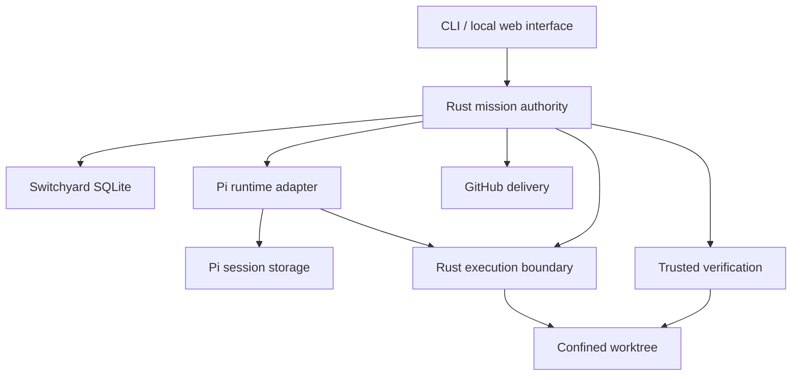

# Rust-first Switchyard prototype

Status: direction accepted 2026-10-29; S1 foundation implemented; S2–S8 are not.  
Planning date: 2026-10-28 (America/New_York).  
Direction update: 2026-10-29 (America/New_York). Rust is the sole long-term engine. Pi Durable is the M1 proof-of-concept adapter.  
S1 decisions recorded 2026-10-29.
Milestone tracker: [#94 — One Recoverable, Verified Change](https://github.com/kortiene/switchyard/issues/94).

## Outcome and user experience

One operator selects a repository and a GitHub issue, freezes an objective and acceptance criteria, approves a plan, steers an implementation, reviews independent verification, and explicitly publishes one pull request. A browser disconnect does not cancel the mission. A host restart recovers persisted state and reconciles interrupted work before continuing.

The decisive demonstration is: start a real change, steer it, restart the host, recover the same attempt, observe a failed verification, repair within limits, approve the exact result, and publish one PR while preserving the original checkout's branch, HEAD, index, and working tree.

Recovery is conditional on the host, session storage, and workspace being available. An uncertain external effect enters `needs_attention`; it is not silently repeated or declared successful.

Read the [runtime protocol](runtime-protocol.md) and [delivery plan](delivery-plan.md) before implementation.

## Repository baseline

The inspected Switchyard main is [`4b07a8ed72be`](https://github.com/kortiene/switchyard/tree/4b07a8ed72be97b4eb7dd5a5a37ad89d4eae4c21). It is a TypeScript/Node control plane in `adw_sdlc/`, with phase orchestration, four runner adapters, explicit project checks, Git/forge authority, and persisted ADW state. Its existing Pi runner is not evidence of Pi Durable integration. Run `babe0070` (PR #73) is partial evidence for that legacy runner only: it needed one scope fix from the owner, and an unassisted Pi real-issue run is still owed. `runner-pi` and the TypeScript execution path are frozen legacy (fixes only), to be retired with the TypeScript engine.

Existing implementation and reference sources:

- [Orchestrator](../../adw_sdlc/src/orchestrator.ts), [state](../../adw_sdlc/src/state.ts), and [runner seam](../../adw_sdlc/src/invoker.ts).
- [Control-plane invariants](../../wiki/decisions/invariants.md) and [worktree design](../../adw_sdlc/docs/DESIGN-managed-git-worktrees.md).
- [Current package guide](../../adw_sdlc/README.md), [readiness](../../adw_sdlc/MVP-READINESS.md), and [contributor workflow](../../wiki/workflows/contributing.md).

Switchyard is unreleased and has no users. Rust is the sole engine long term, including a native Rust agent runtime. Pi Durable 1.4.0 behind the sandboxed TypeScript bridge is the M1 proof-of-concept runtime behind a replaceable adapter, not the end state. Keep `adw_sdlc/`, its CLI, runtime defaults, and generated prompt mirrors in tree as a reference while useful. Do not move or delete that package as part of M1. There is no long-term coexistence or user-compatibility promise. State v1 (`adw/state.schema.json`, `agents/<adw-id>/state.json`) is frozen as is: no further changes and no new consumers. Rust missions do not resume legacy ADW runs.

## Architecture decision

Rust owns the product's durable authority. For M1, Pi Durable 1.4.0 is the proof-of-concept agent runtime behind a bundled, trusted, sandboxed TypeScript adapter. The native Rust agent runtime is the target that replaces that adapter.

| Owner | Responsibilities |
| --- | --- |
| Rust core | Mission transitions, authorization, plan approval, limits, command outbox, recovery decisions |
| Rust execution boundary | Worktree ownership, confined file/process operations, process-tree supervision, operation receipts |
| Rust verification and delivery | Trusted evidence, content-bound review, approval validity, Git and GitHub mutations |
| Pi Durable 1.4.0 (proof of concept) | Conversation, model requests, internal tasks, tool lifecycle, steering inbox, session persistence, behind the replaceable adapter |
| Interface | Send commands with identity/revision checks; display committed state and explicit uncertainty |

This is Rust-first, not a claim that M1 is already a Node-free or single-executable implementation. The native Rust agent runtime is the long-term target, not an optional later evaluation. M1 still proves the mission core against the Pi Durable proof of concept. Runtime replacement applies to new attempts; live Pi session migration is not promised.

Start with one Rust library crate and one executable, using modules before adding more crates. S1 adds `crates/switchyard-core/` and `crates/switchyard/`. `runtime/pi/`, `web/`, and `tests/acceptance/` remain planned paths, not packages or usable product commands.

## Runtime baseline

Pi was inspected at [`e65b3b88c084`](https://github.com/earendil-works/pi/tree/e65b3b88c08412bb8ffbd21fb5dc5756064a6e5a). Its [package manifest](https://github.com/earendil-works/pi/blob/e65b3b88c08412bb8ffbd21fb5dc5756064a6e5a/packages/durable/package.json) reports version 1.4.0 and Node >=22.19.0. The [README](https://github.com/earendil-works/pi/blob/e65b3b88c08412bb8ffbd21fb5dc5756064a6e5a/packages/durable/README.md) identifies the API as experimental.

S2 must establish an exact installable version and lockfile, supported Node version, source/package compatibility, and public API contract tests. A source version string does not prove a registry release is available.

Relevant semantics:

- Pi commits tool intent before executing it. Interrupted calls rerun only under their replay policy; replay-safe external effects still need idempotency/reconciliation.
- Submission request IDs support deduplication after a lost acknowledgment.
- A steer is applied at a supported tool-round boundary, not an immediate preemption.
- Submission answered, runtime idle, verification passed, and human approved are different facts. Pi after-run tasks may still run after a submission is answered.
- One process owns a Pi storage at a time. The host must prevent competing owners.
- SQLite's documented NORMAL synchronization survives process crashes but does not guarantee the latest commits survive power/host failure. Configure and validate the required durability policy in S1/S2; backups and lost-host recovery are separate.
- Pi does not force-terminate non-cooperative extension code in-process. Rust must supervise the process and the execution environment.

Sources: [README](https://github.com/earendil-works/pi/blob/e65b3b88c08412bb8ffbd21fb5dc5756064a6e5a/packages/durable/README.md), [specification](https://github.com/earendil-works/pi/blob/e65b3b88c08412bb8ffbd21fb5dc5756064a6e5a/packages/durable/docs/spec.md).

## Domain model

| Record | Durable meaning |
| --- | --- |
| Mission | Objective, source issue snapshot, repository identity, current revision |
| Task | One work unit with frozen acceptance criteria; only one root task in M1 |
| Attempt | One execution snapshot: base SHA, task, runtime/model configuration, policy, verifier, environment and session binding |
| Command | Authorized operation with stable ID, payload hash, expected revision and delivery state |
| Operation receipt | External effect identity, intent, known outcome or explicit uncertainty |
| Evidence | Host-collected observations with content hashes, completeness and provenance |
| Verification | PASS / FAIL / ERROR / INCOMPLETE against frozen requirements and inspected content |
| Decision | Actor, action, rationale and exact plan/review digest |
| Delivery | Authorized repository/branch target, tree/commit identity, publication state and PR identity |

A runtime restart retains the business Attempt. A new scope, changed policy, or explicitly abandoned attempt creates a successor with new authority; old evidence/decisions remain auditable. A bounded repair within an attempt creates a new review revision and invalidates earlier verification/approval.

## Normative mission transitions

This table is normative for the proposed M1 implementation. Rust rejects every unlisted state transition. Each accepted transition checks the expected mission revision and atomically records its command/decision, resulting revision, and any outbox entry. Runtime notifications are observations used by Rust to evaluate guards; they cannot set mission state. Steering and inspection may leave state unchanged and still receive durable command receipts.

| From | Command or reconciled observation | Guard and required effect | To |
| --- | --- | --- | --- |
| draft | start planning | Freeze attempt inputs and policy; acquire exclusive ownership; planning tools are read-only | planning |
| planning | plan completed | Persist the complete plan and its digest; planning work is quiescent | awaiting_plan_approval |
| awaiting_plan_approval | request revised plan | Record feedback; invalidate the old plan decision; enforce usage limits | planning |
| awaiting_plan_approval | approve plan | Authorized actor confirms current plan digest; implementation policy is unchanged | implementing |
| implementing | request verification / implementation settles | Freeze new mutation admission; confirm runtime and all writers quiescent; retain any interrupted effects for reconciliation | verifying |
| verifying | complete PASS | Every frozen requirement passes with complete evidence for the current stable content | awaiting_review |
| verifying | authorize bounded repair | FAIL is attributable to repairable code; policy permits repair; writers quiescent; limits available; atomically increment persistent repair count and invalidate old review/approval | implementing |
| awaiting_review | request changes | Authorized feedback stays within frozen scope; writers quiescent; limits available; increment persistent repair count and invalidate old evidence/approval for the new revision | implementing |
| awaiting_review | approve review | Confirm current digest, complete PASS and unchanged content; record actor/rationale | approved |
| approved | publish | Explicit publication authority for this digest and target; revalidate frozen content; record delivery intent before external effects | publishing |
| publishing | reconcile delivery complete | Exact approved tree/commit and one matching PR are proven; record delivery receipt | published |
| awaiting_plan_approval, awaiting_review, approved | reject | Record explicit rejection; no delivery is in flight; writers quiescent | rejected |
| draft, planning, awaiting_plan_approval, implementing, verifying, awaiting_review, approved | pause | Record resume target; close new admission and request drain/stop | pausing |
| pausing | confirm stopped | Runtime and every writer quiescent; interrupted effects reconciled | paused |
| paused | resume | Explicit authorization; original resume target revalidated with the same guards, plan/content/policy checks and ownership; no silent approval reuse | saved resume target |
| Any nonterminal state except cancelling | cancel | Close admission, persist cancellation intent, request stop; retain in-flight publication receipts | cancelling |
| cancelling | confirm cancelled | All writers stopped, effects reconciled, and no matching published PR exists; retain any already-created branch/commit | cancelled |
| cancelling | discover publication already completed | Exact authorized delivery/PR is proven; cancellation cannot undo publication | published |
| Any nonterminal state except needs_attention | detect uncertainty, invalid approval, ERROR/INCOMPLETE, exhausted limits, or failed stop | Revoke mutation/publication admission; persist prior phase, reason and permitted recovery target; invalidate stale evidence/approval | needs_attention |
| needs_attention | explicit recovery | Prove ownership and effect outcomes; restore only a recorded, revalidated normal phase or paused; require that phase's guards; content drift returns to verifying, never directly approved | validated recovery target |

Normal phases are draft, planning, awaiting_plan_approval, implementing, verifying, awaiting_review, approved, and publishing. Recovery cannot jump past a failed gate: pending stop/cancel intents must settle before resuming, and uncertain publication must reconcile before another publish attempt. A pause during publishing is rejected; cancellation during publishing follows the delivery-reconciliation rows above.

published, rejected, and cancelled are terminal for the attempt. A successor attempt requires an explicit new command and identity; terminal records are never reopened. Policy/scope/verifier changes also require a successor attempt and new plan approval. A restart is not a new business attempt.

A verification FAIL does not authorize unlimited automatic repair. Its guarded repair edge must consume a persisted allowance; ERROR/INCOMPLETE and unresolved external effects go to needs_attention. Changes after approval first invalidate it and enter needs_attention; reinspection/reverification and a new review are required before delivery.

Plan approval authorizes implementation under the frozen policy. Delivery approval authorizes an exact reviewed result and target. Steering can refine work within policy; it cannot expand capabilities, alter acceptance tests, or approve publication.

## S1 resolutions

S1 (#95) implements the ledger and transition kernel with the clarifications below. They specify table edges the plan left to the implementation. They do not add Pi, confinement, live verification, or GitHub publication.

- **Recovery targets.** Entering `needs_attention` stores one permitted target. `cancelling` is stored when that is the prior phase so cancellation can settle; it is not a normal phase and does not resume work. `pausing` and `paused` recover to `paused` only after quiescence is proven. An in-flight delivery recovers to `publishing` as reconcile-only: content drift does not skip that reconciliation, and `publish` is not an edge from `publishing`. Invalid approval, verification error, and incomplete verification recover to `verifying` when no delivery is in flight. Explicit recovery must name that validated target. A saved `awaiting_review` or `approved` resume target is revalidated against current complete PASS evidence for the current content digest, not against `reviewed_digest` (that digest is absent before approval). Invalidated or missing PASS evidence changes the saved resume target to `verifying` while the mission stays paused. Drift from `approved` or `awaiting_review` as the recovery phase itself still validates to `verifying`, never `approved`.
- **Stop and resume.** `confirm_stopped` and `confirm_cancelled` are rejected while their runtime abort is still pending, or while admitted runtime work has no delivered abort. Pending aborts are not superseded once runtime work was admitted. Resume, and recovery into `planning` or `implementing`, enqueues a new runtime continuation in the same transaction when that phase has no admitted runtime work. Superseded commands are not revived.
- **Terminal evidence and notification quarantine.** Terminal missions reject verification observations before any evidence or verification row is written. Evidence that belongs to a transition is committed in that same transaction. Permanently invalid runtime notifications (`illegal_transition`, `terminal_immutable`, stale or invalid frames, and other validation errors) are removed from the queue and stored in `notification_quarantine`, which `mission status` lists. Only storage and git IO errors stay at the head of the queue for retry.
- **Verification FAIL** records evidence and does not change phase. Only `authorize_bounded_repair` consumes the persisted allowance. ERROR and INCOMPLETE are uncertainty observations.
- **One verification edge.** `request_verification` is the single edge for an operator request and for the observation that implementation settled. `plan_completed`, `complete_pass`, `reconcile_delivery_complete`, and `discover_publication_completed` are runtime observations. An operator command cannot certify them, and publication still requires a receipt recorded from `publication_observed`.
- **Successor identity.** Terminal mission rows are immutable. A successor is a new mission and attempt that reference the closed records. A restart is not a new attempt.
- **Durability.** The mission database uses WAL and `synchronous=FULL`. Committed transactions are the process-crash boundary under test. Power loss and lost-host recovery are not claimed.
- **Canonical hashing.** Payload hashes are `sha256:` plus hex SHA-256 of RFC 8785 JSON, restricted to null, booleans, strings, arrays, objects, and integers. Non-integer numbers are rejected. Operation IDs use the M1 formula. Full ES6 number vectors remain an S2 deliverable.
- **Owner lock and CLI.** Mutating opens take an exclusive flock on `<database>.owner.lock` and increment a generation row. `switchyard mission status` is read-only, does not take the lock, and sets SQLite `query_only`. The fake runtime is the only adapter. Create reads Git and does not call GitHub.

## Persistence and recovery

Use separate application-owned and runtime-owned stores. Rust never writes Pi's internal tables. There is no atomic commit across these stores.

1. Persist domain transition plus command outbox entry in one Rust transaction.
2. Dispatch with stable identities and a payload hash.
3. Pi durably admits the submission; the bridge returns its receipt.
4. Rust records acknowledgment and later reconciles completion.
5. On restart, acquire exclusive ownership, inspect Pi state and execution receipts, then reconcile before admitting further work.

A lost reply is not failure evidence. Reuse the same request identity, never a fresh one merely because the connection broke. Notifications improve responsiveness but are not the recovery authority.

Each supervisor activation has a generation. Reject calls/results from stale generations. Generation checks protect admission; they cannot prevent an old process from writing files. Stop or quarantine its execution environment before a replacement can write. If termination is uncertain, retain files and enter needs_attention.

## Workspace and trust boundary

The Rust host creates an owned worktree from an exact base commit and provides a confined ExecutionEnv to the proof-of-concept runtime through the protocol. S3 ([#97](https://github.com/kortiene/switchyard/issues/97)) owns that worktree lifecycle natively in Rust as part of the sandbox. In-progress TypeScript managed-worktree work is stopped and is not this design. M1 targets Linux; S3 must prove one confinement backend on the planned ubuntu-24.04 CI runner and record its actual filesystem, network, process, and resource guarantees. Other host platforms remain unsupported for live execution until separately proven.

Agent-run processes must not access the original checkout, control databases, Pi storage, host credentials, bridge code, or writable Git administrative state. Mediate any required read-only Git inspection. Worktree metadata that refers to the base repository needs explicit mount/access treatment; it is not automatically isolated.

Model-provider credentials belong to the trusted runtime process, not agent shell commands. GitHub publication credentials belong only to the Rust delivery component. Build environments from explicit allowlists. Repository scripts and test code run in confinement too.

### Bridge process confinement and in-process allowlist

The Pi bridge is a separate confined trust domain from the agent execution environment. It holds model credentials and session storage, so forwarding coding operations to Rust is necessary but insufficient.

M1 permits only the pinned Pi Durable/Pi AI runtime and provider/storage adapters, schema validation, deterministic prompt/formatting helpers, and bundled read/write/edit/bash tool adapters whose file/process effects exclusively use the Rust-backed ExecutionEnv. Select these by a host-owned allowlist; freeze their versions and configuration with the attempt. Hooks may validate, record observations, or forward approved operations; they cannot open host tools or broaden policy.

Disable code mode/eval, model-supplied JavaScript, dynamic extension loading, project/user extension discovery, arbitrary MCP servers, direct NodeExecutionEnv, detached subagents, and tools/hooks that perform independent shell/filesystem/network effects. Bundled implementation code is the reviewed trusted computing base; model/repository content is data, never imported or evaluated as host code. Package presence is not permission to register a capability.

| Bridge capability | M1 boundary |
| --- | --- |
| Read | Read-only pinned runtime/package files, immutable host-supplied configuration, and its own session directory |
| Write | Only its private Pi/adapter journal directory and a private bounded temporary directory; neither is agent-accessible |
| Workspace and host filesystem | No direct mount/access to the repository/worktree, Rust mission database, home directory, forge credentials, host sockets or Git metadata |
| Network | OS-enforced default-deny egress except the host-configured model endpoint through a controlled route/proxy and required narrowly controlled resolution; no runtime registry downloads or arbitrary redirects/URLs |
| Process control | No arbitrary child-process creation, ptrace or access to host process credentials; Rust executes commands in the separate agent sandbox |
| IPC | Only inherited supervised channels; requests must pass Rust capability, attempt and generation checks |

Endpoint selection and credentials come from the operator, not the repository/model. Provider endpoints may receive the model context by design; that scoped disclosure is not a general internet capability. The confinement policy must also exclude cloud metadata/local host services and unapproved destination changes. An environment allowlist or an HTTP wrapper alone is not an egress boundary.

Rust supervises bridge resources and lifetime independently of Pi's cooperative cancellation. S3 must demonstrate denied reads/writes/network/child-process attempts from test extension code executing inside the bridge, plus a hung extension that Rust terminates while retaining recoverable storage. If the selected platform cannot enforce either the bridge policy or agent sandbox policy, live execution remains blocked. S2 can prove the protocol with fake providers and execution stubs without claiming these OS guarantees.

Cancellation means stop admission, request runtime abort, stop/drain the entire process tree, and confirm quiescence. Killing a bridge process alone does not prove that descendants stopped.

## Verification and delivery

Rust freezes the verifier definition before implementation and runs it independently of model claims. Observations must cover changes from every tool, including shell commands, and relevant ignored/generated files. Protect the verifier contract; a rewritten test that always exits zero cannot manufacture approval.

Before verification and review, fence/drain writers and inspect a stable workspace. Evidence records command/environment identity, results, output completeness, and content hashes. Missing/truncated evidence, failed confinement, or incomplete requirements block approval.

Bind approval to a digest of the attempt snapshot, reviewed workspace and ordered evidence/verification. Any review-relevant mutation invalidates it. Recheck at approval and publication, with the workspace frozen through materialization; never rely on a time-of-check/time-of-use gap.

Git trees cannot represent every workspace property. Declare and hash the delivery manifest and exclusion ledger, and prove the published tree corresponds to its promoted entries. Retain verifier-visible excluded artifacts needed to audit the claim.

Publishing requires an explicit authorized command. Persist stable delivery identity and expected branch/commit state before effects. On a lost GitHub reply, inspect/reconcile the existing branch and PR before retrying. A foreign branch or unexpected head is a conflict, not permission to overwrite. Do not silently rebase an approved result. M1 ends at PR publication, not merge or a claim of green CI.

## Scope and deferred work

M1: one operator, one active mission, one repository per mission, one Pi Durable proof-of-concept configuration, one supported confinement backend, CLI plus a local mission page, persistent steering, bounded repairs, independent verification, explicit PR publication.

Deferred past M1: Absurd/PostgreSQL fleet orchestration; multi-host handoff; remote multi-user access; collaborative file editing; arbitrary project-supplied plugins; multiple forge providers; automatic merge/deploy; CI repair automation; institutional memory; legacy session migration.

The native Rust agent runtime is the long-term target, not one of those deferred alternatives. M1 uses the Pi Durable proof of concept. Replacing that adapter is later work on the accepted path.

The trusted bundled Pi adapter is not the arbitrary forge-provider plugin mechanism deferred in [#42](https://github.com/kortiene/switchyard/issues/42).

Forgeyard's [review and promotion model](https://github.com/kortiene/forgeyard/blob/293687987d7b7d7104785513bb0c87ffd3efffbb/README.md) is design input for trusted evidence and exact-content approval. This plan does not claim its implementation can be reused unchanged or modify that repository.
