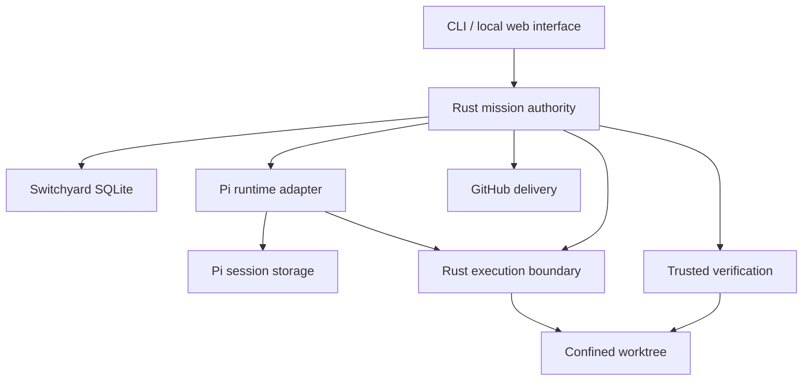

# Rust-first Switchyard prototype

Status: planned prototype; not implemented by this documentation change.  
Planning date: 2026-10-28 (America/New_York).  
Milestone tracker: [#94 — One Recoverable, Verified Change](https://github.com/kortiene/switchyard/issues/94).

## Outcome and user experience

One operator selects a repository and a GitHub issue, freezes an objective and acceptance criteria, approves a plan, steers an implementation, reviews independent verification, and explicitly publishes one pull request. A browser disconnect does not cancel the mission. A host restart recovers persisted state and reconciles interrupted work before continuing.

The decisive demonstration is: start a real change, steer it, restart the host, recover the same attempt, observe a failed verification, repair within limits, approve the exact result, and publish one PR while preserving the original checkout's branch, HEAD, index, and working tree.

Recovery is conditional on the host, session storage, and workspace being available. An uncertain external effect enters `needs_attention`; it is not silently repeated or declared successful.

Read the [runtime protocol](runtime-protocol.md) and [delivery plan](delivery-plan.md) before implementation.

## Repository baseline

The inspected Switchyard main is [`4b07a8ed72be`](https://github.com/kortiene/switchyard/tree/4b07a8ed72be97b4eb7dd5a5a37ad89d4eae4c21). It is a TypeScript/Node control plane in `adw_sdlc/`, with phase orchestration, four runner adapters, explicit project checks, Git/forge authority, and persisted ADW state. Its existing Pi runner is not evidence of Pi Durable integration.

Existing implementation and reference sources:

- [Orchestrator](../../adw_sdlc/src/orchestrator.ts), [state](../../adw_sdlc/src/state.ts), and [runner seam](../../adw_sdlc/src/invoker.ts).
- [Control-plane invariants](../../wiki/decisions/invariants.md) and [worktree design](../../adw_sdlc/docs/DESIGN-managed-git-worktrees.md).
- [Current package guide](../../adw_sdlc/README.md), [readiness](../../adw_sdlc/MVP-READINESS.md), and [contributor workflow](../../wiki/workflows/contributing.md).

The new path is additive. Keep the current CLI, runtime defaults, generated prompt mirrors, project packs, and state v1 contract intact. Do not move or delete the TypeScript implementation as part of M1. Rust missions do not resume legacy ADW runs; any later migration needs an explicit contract.

## Architecture decision

Rust owns the product's durable authority. Pi Durable is the initial replaceable agent runtime behind a bundled, trusted TypeScript adapter.

| Owner | Responsibilities |
| --- | --- |
| Rust core | Mission transitions, authorization, plan approval, limits, command outbox, recovery decisions |
| Rust execution boundary | Worktree ownership, confined file/process operations, process-tree supervision, operation receipts |
| Rust verification and delivery | Trusted evidence, content-bound review, approval validity, Git and GitHub mutations |
| Pi Durable | Conversation, model requests, internal tasks, tool lifecycle, steering inbox, session persistence |
| Interface | Send commands with identity/revision checks; display committed state and explicit uncertainty |

This is Rust-first, not a Node-free or single-executable implementation. A native Rust agent loop can be evaluated later against measured limitations. Runtime replacement applies to new attempts; live Pi session migration is not promised.

Start with one Rust library crate and one executable, using modules before adding more crates. Proposed new paths are `crates/switchyard-core/`, `crates/switchyard/`, `runtime/pi/`, `web/`, and `tests/acceptance/`. These are planned paths, not existing packages or usable commands.

## Runtime baseline

Pi was inspected at [`e65b3b88c084`](https://github.com/earendil-works/pi/tree/e65b3b88c08412bb8ffbd21fb5dc5756064a6e5a). Its [package manifest](https://github.com/earendil-works/pi/blob/e65b3b88c08412bb8ffbd21fb5dc5756064a6e5a/packages/durable/package.json) reports version 1.4.0 and Node >=22.19.0. The [README](https://github.com/earendil-works/pi/blob/e65b3b88c08412bb8ffbd21fb5dc5756064a6e5a/packages/durable/README.md) identifies the API as experimental.

S2 must establish an exact installable version and lockfile, supported Node version, source/package compatibility, and public API contract tests. A source version string does not prove a registry release is available.

Relevant semantics:

- Pi commits tool intent before executing it. Interrupted calls rerun only under their replay policy; replay-safe external effects still need idempotency/reconciliation.
- Submission request IDs support deduplication after a lost acknowledgment.
- A steer is applied at a supported tool-round boundary, not an immediate preemption.
- Submission answered, runtime idle, verification passed, and human approved are different facts. Pi after-run tasks may still run after a submission is answered.
- One process owns a Pi storage at a time. The host must prevent competing owners.
- SQLite's documented NORMAL synchronization survives process crashes but does not guarantee the latest commits survive power/host failure. Configure and validate the required durability policy in S1/S2; backups and lost-host recovery are separate.
- Pi does not force-terminate non-cooperative extension code in-process. Rust must supervise the process and the execution environment.

Sources: [README](https://github.com/earendil-works/pi/blob/e65b3b88c08412bb8ffbd21fb5dc5756064a6e5a/packages/durable/README.md), [specification](https://github.com/earendil-works/pi/blob/e65b3b88c08412bb8ffbd21fb5dc5756064a6e5a/packages/durable/docs/spec.md).

## Domain model

| Record | Durable meaning |
| --- | --- |
| Mission | Objective, source issue snapshot, repository identity, current revision |
| Task | One work unit with frozen acceptance criteria; only one root task in M1 |
| Attempt | One execution snapshot: base SHA, task, runtime/model configuration, policy, verifier, environment and session binding |
| Command | Authorized operation with stable ID, payload hash, expected revision and delivery state |
| Operation receipt | External effect identity, intent, known outcome or explicit uncertainty |
| Evidence | Host-collected observations with content hashes, completeness and provenance |
| Verification | PASS / FAIL / ERROR / INCOMPLETE against frozen requirements and inspected content |
| Decision | Actor, action, rationale and exact plan/review digest |
| Delivery | Authorized repository/branch target, tree/commit identity, publication state and PR identity |

A runtime restart retains the business Attempt. A new scope, changed policy, or explicitly abandoned attempt creates a successor with new authority; old evidence/decisions remain auditable. A bounded repair within an attempt creates a new review revision and invalidates earlier verification/approval.

Suggested lifecycle: draft -> planning -> awaiting_plan_approval -> implementing -> verifying -> awaiting_review -> approved -> publishing -> published. Explicit paused, cancelling/cancelled, rejected, and needs_attention paths preserve the previous phase and reason. Validate legal transitions in Rust; the runtime cannot set mission status.

Plan approval authorizes implementation under the frozen policy. Delivery approval authorizes an exact reviewed result and target. Steering can refine work within policy; it cannot expand capabilities, alter acceptance tests, or approve publication.

## Persistence and recovery

Use separate application-owned and runtime-owned stores. Rust never writes Pi's internal tables. There is no atomic commit across these stores.

1. Persist domain transition plus command outbox entry in one Rust transaction.
2. Dispatch with stable identities and a payload hash.
3. Pi durably admits the submission; the bridge returns its receipt.
4. Rust records acknowledgment and later reconciles completion.
5. On restart, acquire exclusive ownership, inspect Pi state and execution receipts, then reconcile before admitting further work.

A lost reply is not failure evidence. Reuse the same request identity, never a fresh one merely because the connection broke. Notifications improve responsiveness but are not the recovery authority.

Each supervisor activation has a generation. Reject calls/results from stale generations. Generation checks protect admission; they cannot prevent an old process from writing files. Stop or quarantine its execution environment before a replacement can write. If termination is uncertain, retain files and enter needs_attention.

## Workspace and trust boundary

The Rust host creates an owned worktree from an exact base commit and provides a confined ExecutionEnv to Pi through the protocol. Choose one supported platform/backend in S3 and record its actual filesystem, network, process, and resource guarantees.

Agent-run processes must not access the original checkout, control databases, Pi storage, host credentials, bridge code, or writable Git administrative state. Mediate any required read-only Git inspection. Worktree metadata that refers to the base repository needs explicit mount/access treatment; it is not automatically isolated.

Model-provider credentials belong to the trusted runtime process, not agent shell commands. GitHub publication credentials belong only to the Rust delivery component. Build environments from explicit allowlists. Repository scripts and test code run in confinement too.

Cancellation means stop admission, request runtime abort, stop/drain the entire process tree, and confirm quiescence. Killing a bridge process alone does not prove that descendants stopped.

## Verification and delivery

Rust freezes the verifier definition before implementation and runs it independently of model claims. Observations must cover changes from every tool, including shell commands, and relevant ignored/generated files. Protect the verifier contract; a rewritten test that always exits zero cannot manufacture approval.

Before verification and review, fence/drain writers and inspect a stable workspace. Evidence records command/environment identity, results, output completeness, and content hashes. Missing/truncated evidence, failed confinement, or incomplete requirements block approval.

Bind approval to a digest of the attempt snapshot, reviewed workspace and ordered evidence/verification. Any review-relevant mutation invalidates it. Recheck at approval and publication, with the workspace frozen through materialization; never rely on a time-of-check/time-of-use gap.

Git trees cannot represent every workspace property. Declare and hash the delivery manifest and exclusion ledger, and prove the published tree corresponds to its promoted entries. Retain verifier-visible excluded artifacts needed to audit the claim.

Publishing requires an explicit authorized command. Persist stable delivery identity and expected branch/commit state before effects. On a lost GitHub reply, inspect/reconcile the existing branch and PR before retrying. A foreign branch or unexpected head is a conflict, not permission to overwrite. Do not silently rebase an approved result. M1 ends at PR publication, not merge or a claim of green CI.

## Scope and deferred work

M1: one operator, one active mission, one repository per mission, one Pi runtime configuration, one supported confinement backend, CLI plus a local mission page, persistent steering, bounded repairs, independent verification, explicit PR publication.

Deferred: Absurd/PostgreSQL fleet orchestration; multi-host handoff; remote multi-user access; collaborative file editing; Rust-native agent loop; arbitrary project-supplied plugins; multiple forge providers; automatic merge/deploy; CI repair automation; institutional memory; legacy session migration.

The trusted bundled Pi adapter is not the arbitrary forge-provider plugin mechanism deferred in [#42](https://github.com/kortiene/switchyard/issues/42).

Forgeyard's [review and promotion model](https://github.com/kortiene/forgeyard/blob/293687987d7b7d7104785513bb0c87ffd3efffbb/README.md) is design input for trusted evidence and exact-content approval. This plan does not claim its implementation can be reused unchanged or modify that repository.
